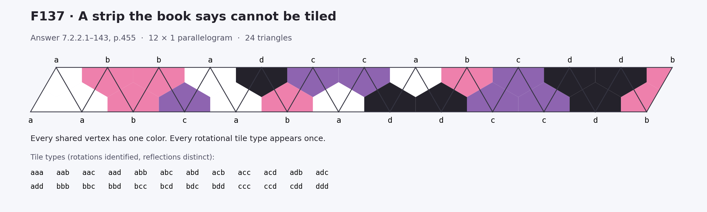

# F137: Langfordovy dílky mohou pokrýt pás 12 × 1

V odpovědi **7.2.2.1–143(b,c), strana 455** svazku 4B je chybné tvrzení,
že tři zbývající konvexní tvary z 24 trojúhelníků nelze sestavit z
Langfordových 24 dílků. Třetí uvedená čtveřice **(12, 12, 1, 0)** odpovídá
rovnoběžníku 12 × 1 a následující sestavení je platným protipříkladem.



## Nejkratší ověření

Každé písmeno označuje barvu jednoho vrcholu. Spodní řada má souřadnice
`(x,0)`, horní `(x,1)`, kde `x = 0,…,12`; souřadnicové osy svírají 60°.

```text
top:     abbadccabcddb
bottom:  aabcabaddccdb
```

Pro každý sloupec `x = 0,…,11` jsou dva trojúhelníky, vždy zapsané proti
směru hodinových ručiček:

```text
bottom[x], bottom[x+1], top[x]
top[x+1], top[x], bottom[x+1]
```

Jeden vrchol má jedinou barvu, takže všechny kontakty automaticky souhlasí.
Všech 24 trojic má navzájem různé typy modulo cyklická rotace a tvoří
celou sadu. Zrcadlení se při rozlišování typů nepovoluje. Ověření nepotřebuje
řešič, další datové soubory ani externí balíčky:

```bash
cd .
python3 audit-2026-10-31/verify_f137.py
```

Tvar je souvislý a konvexní. Má 12 jednotkových kosočtverců, tedy
24 trojúhelníků. Knižní parametrizace mu dává obvodovou posloupnost
`(12,0,1,12,0,1)` a obsah `13²−12²−1² = 24`.

## Přesný rozsah a zdroje

Znění bylo prohlédnuto v původní stránce našeho **druhého dotisku 4B**:
[strana 455](images/vol4b-p455-polygons143.png). Čtveřice je v tomto PDF
správně; chybná je až navazující věta o nemožnosti sestavení.

[Autorův draft z roku 2019](images/fasc5c-p159-polygons143.png) má stejnou
větu, ale ještě chybnou třetí čtveřici `(5,1,1,0)`. Její veřejná oprava
na `(12,12,1,0)` je z **21. října 2021** a v našem 4B už je zapracovaná
(E071). Draft proto nepočítáme jako přesné nezávislé potvrzení stejného
konkrétního případu. Po aplikaci E071 však v něm chybný závěr zůstane.

Šest aktuálních a historických vrstev errat 4B a Fascicle 5 neobsahuje
odpovídající opravu nemožnosti pokrytí. Oficiální originály byly znovu
staženy **3. listopadu 2026 v 05:37 UTC** a byly beze změny.
[Hledané výrazy, kontexty a hashe](results/polygons143/errata-check.json).
Ve stejné odpovědi je známá oprava parity E069; ta není novým nálezem
a nespravuje toto tvrzení o dílcích.

Původní DLX2 navíc dokončil úplný výčet **206 472 pojmenovaných sestavení**.
Nezávislý řešič, který přiřazuje barvy přímo vrcholům, našel **8 603 tříd
po přejmenování barev**. Protipříklad stojí sám o sobě na výše uvedených
dvou řádcích. Stav přímé validace všech modelů a shody celých množin je
v [záznamu přijetí](results/polygons143/tilings/accepted.json).

Opravené tvrzení: ze šesti konvexních tvarů lze pokrýt **čtyři**; nepokrytelné
jsou `(7,5,0,0)` a `(2,2,2,2)`. Obě nulové hodnoty mají dva dokončené
nezávislé výčty. Tři původní pokrytelné tvary již ověřil audit úlohy 140.

Závažnost je **střední**: jde o nepravdivé matematické tvrzení s krátkým
protipříkladem. Tištěný exemplář, úplná nejnovější digitální verze ani
prvenství nebyly ověřeny. Žádné hlášení nebylo odesláno.
